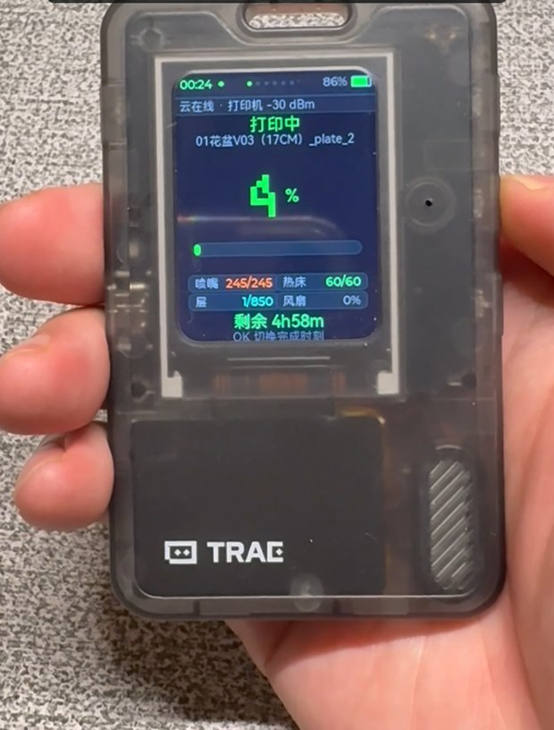
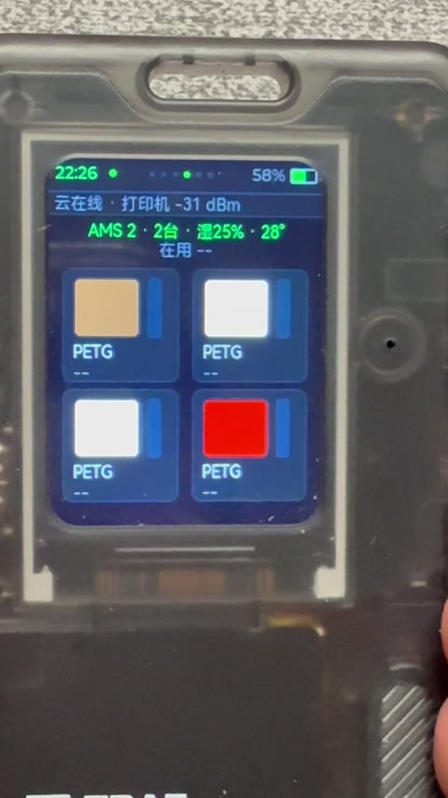
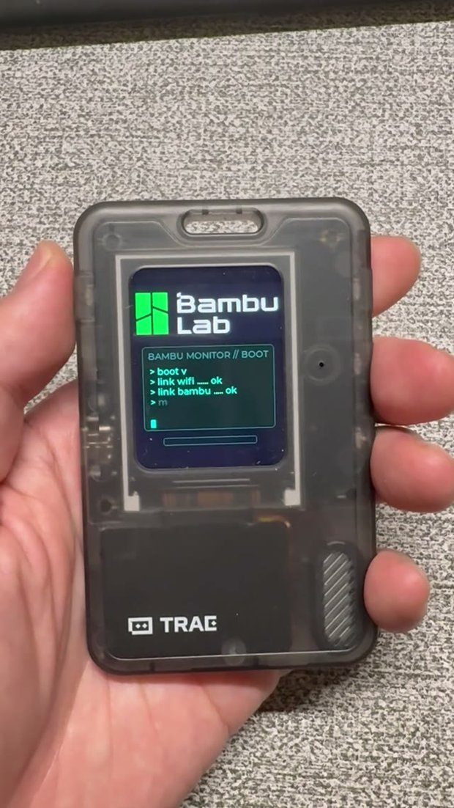

# PrintPet Firmware

[简体中文](README.zh_CN.md) | English

A community 3D-printing companion for Bambu Lab printers, running on third-party [FoloToy AI Passport](https://github.com/FoloToy/ai-passport) hardware. AI Passport is FoloToy's hardware name; PrintPet is this project's software brand. This community derivative is not affiliated with or endorsed by FoloToy or Bambu Lab.

## Product lines

- **PrintPet Core**: the 1.x monitoring line for progress, temperatures, AMS filament, HMS alerts and device information, without character animation or character speech. The current source builds the read-only **1.5.1 candidate**; no new tag, release or device acceptance is implied. The historical `v1.5.0` tag is unchanged.
- **PrintPet Spirit**: the 2.x line adds character animation, per-page dialogue and voice, state-event voice, and volume/brightness settings to the core monitoring experience. Version `2.1.8` remains in internal testing. Its source and firmware have not been published on GitHub, and it has no public tag or release.

Both lines use FoloToy AI Passport hardware and the same provisioning flow. The Windows desktop product remains **PrintPet - 打印小监工**, available from [PrintPet Releases](https://github.com/ericwubeta/PrintPet-releases). Sharing a brand does not imply desktop AI chat in the firmware or implemented synchronization between the two products.

## Read-only scope and historical-version difference

The current Core source is read-only monitoring: no control page, pause/resume/stop API or light-control API. It subscribes to printer reports and sends only a fixed `pushing.command = pushall` request for status refresh, including reconnect, the periodic poll and manual refresh. It exposes no arbitrary command/payload publisher.

**The historical public `v1.5.0` tag still contains a control page and the `app_mqtt_print_command` / `app_mqtt_set_chamber_light` sending APIs.** Those paths are removed from the current 1.5.1 source; the old tag and previously built binaries have not been rewritten. The new candidate was compiled and host-tested without accessing a printer, and has not been flashed or tested on physical hardware. Spirit source and assets remain unpublished.

The firmware repository is [ericwubeta/printpet-firmware](https://github.com/ericwubeta/printpet-firmware). The `passport_printer` build identifier and `passport_printer.bin` artifact name remain compatible identifiers, not product names.

## Core monitoring features

- **Live print status** — state, progress %, layer/nozzle counts, elapsed/remaining time
- **Temperatures** — bed, nozzle and chamber target/current values
- **AMS filament** — up to 4 AMS × 4 slots: material, color, name and remaining grams (manual spools without RFID are handled correctly)
- **HMS alerts** — error codes shown in the status bar with a notification sound
- **Device page** — printer model, serial, firmware and connection state
- **On-device provisioning** — softAP + web page; Wi-Fi and Bambu credentials are stored in NVS, never compiled in
- **Phone-only SMS login** — enter the Bambu phone number and SMS code on the provisioning page; the device fetches the User ID, token and printer serials by itself, no PC required
- **Scan-and-pick Wi-Fi** — the provisioning page scans nearby 2.4 GHz networks; tap one to fill the SSID, and delete saved networks from the phone
- **3 saved Wi-Fi networks** — on boot the badge connects to the strongest known network and rotates to the next after repeated failures (home ↔ phone hotspot)
- **On-device Wi-Fi switcher** — the menu lists saved networks for manual switching; the status bar always shows the current SSID
- **Multi-printer** — monitor up to 4 printers on the same Bambu account via a card overview with per-printer detail pages (testing status below)
- **Cyber boot animation** — terminal-style boot log drawn entirely with LVGL primitives
- ~10 s telemetry refresh, heap-stable for days of continuous monitoring

## Screenshots

<p align="center">
  
</p>
<p align="center">
  <em>Print progress: state, temperatures, layers, remaining time</em>
</p>

These are historical v1.5.0 screenshots, not the unpublished Spirit UI or new branding.

| AMS filament slots | Boot animation |
| :---: | :---: |
|  |  |

## Hardware

| Item | Spec |
| --- | --- |
| MCU | ESP32-C3 (single-core RISC-V, 400 KB SRAM, no PSRAM) |
| Display | 1.69" 240×320 ST7789 SPI, rounded corners (r = 30 px) |
| Input | 3 ADC buttons (up / down / OK, long-press OK = back) |
| Audio | ES8311 codec + speaker |
| Fuel gauge | CW2017 (500 mAh Li-Poly profile) |
| Flash | 8 MB (4 MB factory app + SPIFFS/data) |

## How it works

```
Bambu Cloud (cn.mqtt.bambulab.com:8883, TLS)
        │  device/<sn>/report  (push, ~10 s)
        ▼
ESP32-C3  ── JSON parse ── LVGL pages ── ST7789
   │  app_mqtt.c      app_printer.c
   └── credentials from NVS (app_config.c), written by the provisioning page
```

Pages are switched with up/down; long-pressing OK returns to the menu
(Printer / Provisioning / Wi-Fi). The button
callback only records the event — heavy rendering runs from an LVGL timer, which
avoids stack overflows on the button component's small callback task.

## First-time setup (phone only, no rebuild needed)

1. Flash the firmware and power on. When unprovisioned, the device opens a Wi-Fi hotspot:
   - SSID: **Bambu-Setup**　Password: **setup123**
   (Already provisioned? Long-press OK for the menu and pick "配网/Provision".)
2. Connect a phone to it and open <http://192.168.4.1>.
3. **Join Wi-Fi**: tap **Scan**, pick a 2.4 GHz network, enter its password and tap **连接这个 WiFi**.
   The device stays in APSTA mode, keeping the hotspot up while joining your router. The hotspot may
   briefly change channel during the join; reconnect the phone if it drops.
4. **Bambu SMS login**: enter the account phone number → **发送验证码** → enter the 6-digit SMS code →
   **登录并完成配置**. The device calls the Bambu API directly and fills in the **User ID, accessToken
   and printer serials** (first 4 printers), saves them to NVS and reboots into the monitor page after 5 s.
5. No PC or manual token entry is needed. The collapsed **高级：手动填 Token / 序列号** section remains
   for API changes or per-printer edits; the PC tools `tools/get-token.bat` / `tools/weblogin.py` still
   work as a fallback.

Credentials live only in the device's NVS partition. As a legacy fallback,
`main/secrets.h` (git-ignored; copy from `main/secrets.h.example`) can carry
compile-time defaults.

> Token note: the Bambu accessToken is an account session credential and
> expires periodically. Re-provision when the cloud indicator stays
> disconnected. Only flash firmware containing your own token to devices you
> own.

## Wi-Fi management & switching

- **Up to 3 networks** — add / overwrite / delete from the provisioning page; re-adding the same SSID updates its password
- **Automatic network selection** — on boot the badge scans and connects to the strongest known network; a network that fails 3 times is skipped for the next one
- **Manual switching on the device** — long-press OK → menu → "Wi-Fi" → choose a network with up/down and press OK; the connected one is marked `当前` (current)
- **Current SSID visible** — the status bar shows `Cloud online · <SSID>`; the device page shows the SSID and signal strength
- **2.4 GHz only** (ESP32-C3 hardware limit). Captive-portal Wi-Fi (hotels, airports) cannot be used — use a phone hotspot instead

**Tested on hardware:**

| Scenario | Status |
| --- | --- |
| Scan, add and delete networks from the provisioning page | ✅ Verified |
| Two saved networks, automatic switch-over | ✅ Verified |
| Manual switching from the device menu | ✅ Verified |
| Long / CJK SSID names do not overflow | ✅ Verified (status bar and device page) |

## Multi-printer support & testing status

Up to **4 printers on the same Bambu account** can be monitored at once:

- The provisioning page accepts 2–4 serial numbers with optional custom names (e.g. `Study X1C`)
- With 2+ printers configured, the device opens a **printer overview** (each card shows name, state dot, progress % and remaining time; printers with HMS alarms are highlighted) — press OK to open a printer's detail pages, long-press OK to return to the overview
- With exactly 1 printer the behaviour is identical to the single-printer firmware
- All printers share one cloud connection (single TLS/MQTT session, one report topic per printer)

**Testing status — please read before relying on this feature:**

| Scenario | Status |
| --- | --- |
| Single printer (regression) | ✅ Verified on hardware, long-run stable, watchdog-free |
| Multi-printer UI, navigation, per-printer data routing | ✅ Verified on hardware in **simulation** (1 real printer + 3 injected test serial numbers) |
| Real data while subscribed to 4 topics at once | ✅ Verified on hardware |
| **Two or more *real* printers streaming simultaneously** | ⚠️ **Not tested** — the author only owns one printer. The topic routing is standard MQTT, but this scenario has no hardware confirmation yet |
| Provisioning page with multiple serial numbers | ⚠️ Form parsing code-reviewed, not end-to-end tested on hardware |

For testing without extra hardware, `main/app_mqtt.c` has a simulation switch: set `TEST_EXTRA_MACHINES` to 1/2/3 to inject that many fake printers next to the real one. **It defaults to 0 (off) and must stay 0 in release builds.**

If you run two or more real printers and hit an issue, please open an issue — real multi-printer feedback is very welcome.

## Building

Native transport/navigation checks are documented in [tests/host](tests/host/README.md). The transport test captures actual `app_mqtt.c` output for 1–4 dummy printers; the LVGL test covers the monitoring page cycle, 0–4 AMS, refresh buttons and overview/detail reentry. Fixtures do not establish real multi-printer or device-memory acceptance.

Requires ESP-IDF **5.5.x** (tested with 5.5 release on Windows).

```bash
idf.py set-target esp32c3
idf.py build
idf.py -p COM5 flash monitor
```

Partition layout (`partitions.csv`): NVS + PHY + 4 MB factory app on 8 MB flash.
Flashing keeps NVS, so re-flashing does not erase provisioning data.

## Project layout

```
main/
  app_printer.c     read-only UI: status / temperatures / AMS / device pages
  app_mqtt.c        Bambu Cloud MQTT client + JSON telemetry parsing
  app_provision.c   softAP + HTTP provisioning page
  app_config.c      NVS-backed credential store
  app_wifi.c        Wi-Fi connection (NVS credentials, secrets.h fallback)
  app_boot.c        boot animation
  app_notify.c      HMS alert text + sound
  hms_codes.c       HMS code catalog (Chinese)
  font_zh*.c        subset Chinese pixel fonts
components/bsp/     board support: display, buttons, audio, battery, I2C
tools/              font symbol generation, serial capture, syntax check
```

## Security

- No real credentials are committed. `main/secrets.h` is git-ignored; only the
  `.example` placeholder template is tracked.
- Logs containing serial numbers are local-only (`*.log` is git-ignored).
- When distributing your own build, review `sdkconfig` and never publish a
  binary compiled with real credentials.

## Acknowledgements

- [FoloToy/ai-passport](https://github.com/FoloToy/ai-passport) — hardware baseline, BSP and LVGL framework (MIT)
- Bambu Lab — printer telemetry consumed through the official cloud MQTT channel

## License

[MIT](LICENSE), Copyright © 2026 FoloToy, Copyright © 2026 EricWU.
This project is a community derivative and is not affiliated with or endorsed by Bambu Lab or FoloToy.
