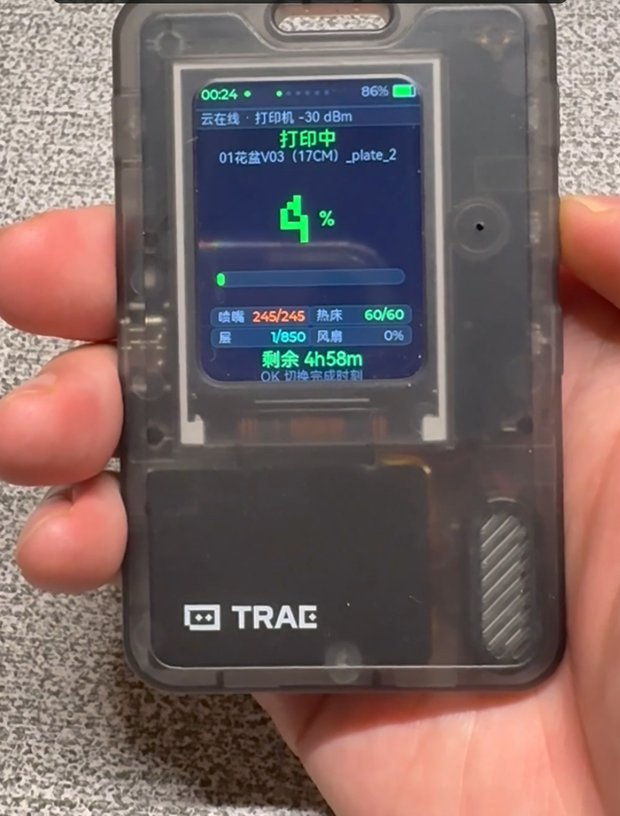
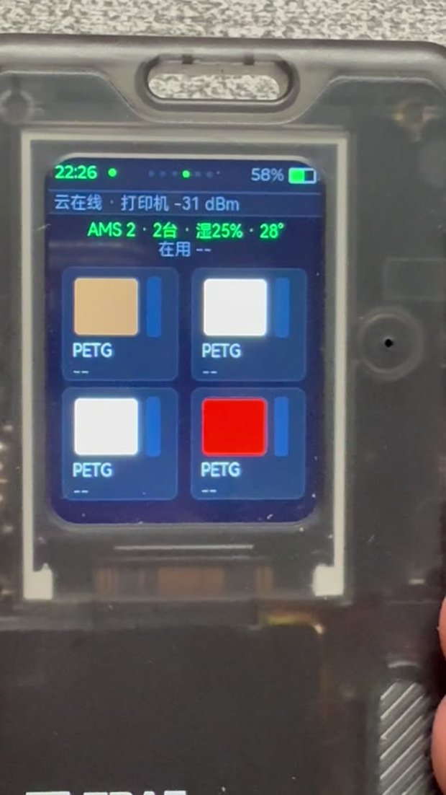
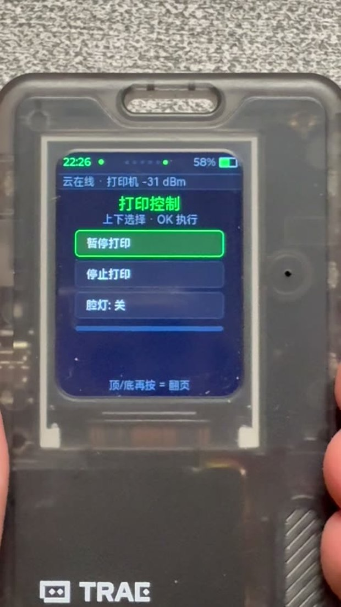
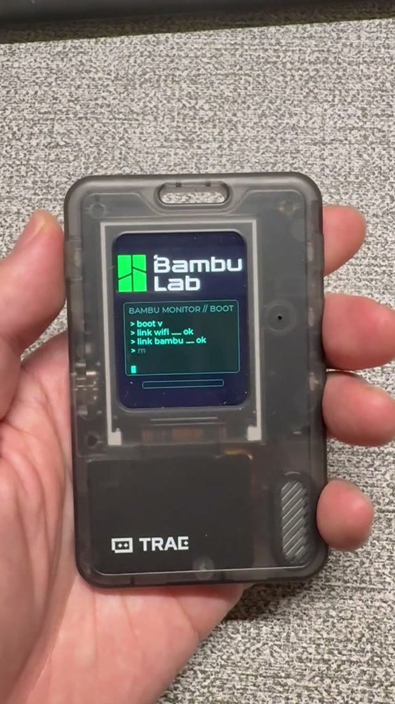

# AI Passport · 拓竹 3D 打印机监控固件

English | [简体中文](README.zh_CN.md)

基于 [FoloToy AI Passport](https://github.com/FoloToy/ai-passport) 硬件（ESP32-C3）的可穿戴拓竹打印机监控固件。
订阅拓竹云 MQTT 实时数据流，在 240×320 圆角屏上显示打印进度、温度、AMS 料槽和设备信息，无需掏出手机。

## 功能

- **实时进度**：状态、百分比、层数/喷嘴点数、已用/剩余时间
- **温度监控**：热床、喷嘴、腔体温度的目标值/当前值
- **AMS 料槽**：最多 4 台 AMS × 4 槽，显示材质、颜色、料名与剩余克数（正确处理无 RFID 的手动耗材）
- **HMS 告警**：错误码显示在常驻状态条并播放提示音
- **设备页**：打印机型号、序列号、固件版本与连接状态
- **控制页**：通过云端通道下发暂停 / 继续 / 停止 / 腔灯指令（打印机是否执行取决于账号权限，第三方 token 通常为只读）
- **设备端配网**：热点 + 网页配置，WiFi 与拓竹凭据只存 NVS，不编进固件
- **赛博开机动画**：终端风格逐字启动日志，纯 LVGL 图元绘制
- 约 10 秒刷新一次遥测，堆内存稳定，可连续监控数日

## 效果截图

<p align="center">
  
</p>
<p align="center">
  <em>打印进度:状态、温度、层数、剩余时间</em>
</p>

| AMS 料槽 | 打印控制 | 开机动画 |
| :---: | :---: | :---: |
|  |  |  |

## 硬件

| 项目 | 规格 |
| --- | --- |
| MCU | ESP32-C3（单核 RISC-V，400 KB SRAM，无 PSRAM） |
| 屏幕 | 1.69" 240×320 ST7789 SPI，圆角 r = 30 px |
| 按键 | 三键 ADC 分压（上 / 下 / 确定，长按确定返回） |
| 音频 | ES8311 codec + 喇叭 |
| 电量计 | CW2017（500 mAh 锂电 profile） |
| Flash | 8 MB（4 MB factory 应用 + 数据区） |

## 工作原理

```
拓竹云 (cn.mqtt.bambulab.com:8883, TLS)
        │  device/<序列号>/report （推送,约 10 秒）
        ▼
ESP32-C3  ── JSON 解析 ── LVGL 页面 ── ST7789
   │  app_mqtt.c        app_printer.c
   └── 凭据取自 NVS(app_config.c),由配网页写入
```

上/下键切换页面，长按确定返回菜单。按键回调只记录事件，重绘放到 LVGL
定时器任务里执行，避免在按键组件的小栈回调上做重活导致栈溢出重启。

## 首次配网（无需重新编译）

1. 刷入固件并开机。
2. 未配置时设备自动开启热点：
   - 热点名：**Bambu-Setup**　密码：**setup123**
3. 手机或电脑连上热点，打开 <http://192.168.4.1>。
4. 填写：
   - 家中 WiFi 名称 / 密码
   - 拓竹 **User ID**（`u_` 后面的纯数字部分）
   - 拓竹云端会话的 **accessToken**
   - 打印机**序列号**（15 位，如 `00C00AAAA000000`）
5. 保存后设备自动重启、联网并进入监控页。

凭据仅保存在设备 NVS 分区。作为老版本兜底，可用
`main/secrets.h.example` 复制出 `main/secrets.h`（已被 git 忽略）写入
编译期默认值。

> Token 说明：accessToken 属于账号会话凭据，会周期性过期；云端指示点
> 长时间断开时请重新配网。含真实 token 的固件只应刷入你自己的设备。

## 编译

需要 ESP-IDF **5.5.x**（Windows 上使用 5.5 release 验证通过）。

```bash
idf.py set-target esp32c3
idf.py build
idf.py -p COM5 flash monitor
```

分区表（`partitions.csv`）：8 MB Flash 上 NVS + PHY + 4 MB factory 应用。
烧写不擦除 NVS，重新刷固件不会丢失配网信息。

## 目录结构

```
main/
  app_printer.c     监控 UI:进度/温度/AMS/设备/控制页
  app_mqtt.c        拓竹云 MQTT 客户端与 JSON 遥测解析
  app_provision.c   softAP + HTTP 配网页
  app_config.c      基于 NVS 的凭据存储
  app_wifi.c        WiFi 连接(NVS 凭据,secrets.h 兜底)
  app_boot.c        开机动画
  app_notify.c      HMS 告警文本与提示音
  hms_codes.c       HMS 错误码中文目录
  font_zh*.c        子集化中文像素字体
components/bsp/     板级支持:显示/按键/音频/电量/I2C
tools/              字体符号生成、串口抓取、语法检查
```

## 安全说明

- 仓库不含任何真实凭据：`main/secrets.h` 已被 git 忽略，只跟踪
  `.example` 占位模板。
- 含序列号的运行日志仅保留在本地（`*.log` 已被 git 忽略）。
- 分发自己的构建前请检查 `sdkconfig`，切勿发布内嵌真实凭据的二进制。

## 致谢

- [FoloToy/ai-passport](https://github.com/FoloToy/ai-passport) —— 硬件基线、BSP 与 LVGL 框架（MIT）
- 拓竹科技 —— 通过官方云 MQTT 通道获取打印机遥测

## 协议

[MIT](LICENSE)，Copyright © 2026 FoloToy，Copyright © 2026 EricWU。
本项目为社区衍生作品，与拓竹科技、FoloToy 无隶属或背书关系。
