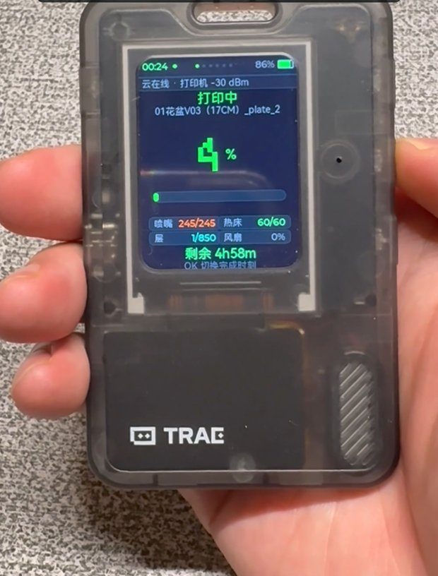
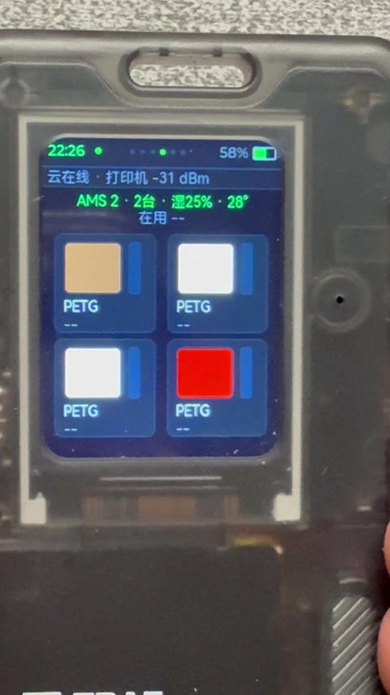
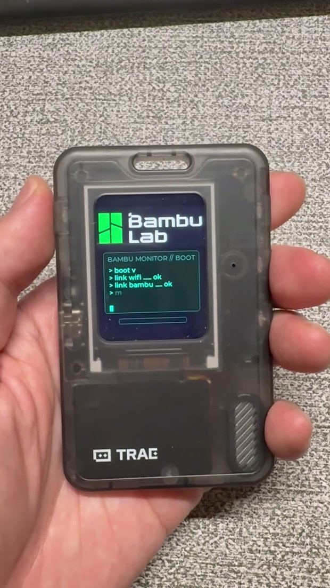

# PrintPet 固件

[English](README.md) | 简体中文

面向拓竹打印机的社区 3D 打印伴侣固件，运行在第三方 [FoloToy AI Passport](https://github.com/FoloToy/ai-passport) 硬件上。AI Passport 是 FoloToy 的硬件名称，PrintPet 是本项目的软件品牌；本项目与 FoloToy、Bambu Lab 无官方关联或背书。

## 产品线

- **PrintPet Core**：1.x 核心监控线，显示进度、温度、AMS 耗材、HMS 告警与设备信息，没有精灵角色或角色语音。**v1.5.1 已发布到 [GitHub Release](https://github.com/ericwubeta/printpet-firmware/releases/tag/v1.5.1)**，附应用固件与校验和；请按[仅应用区升级说明](docs/UPGRADE-v1.5.1.md)操作。本次二进制的实机验收仍待完成，历史 `v1.5.0` tag 保持原样。
- **PrintPet Spirit**：2.x 在核心监控基础上增加精灵动画、逐页台词/语音、状态事件语音及音量/亮度设置。当前 `2.1.8` 仍在内测，源码和固件尚未公开到 GitHub，没有公开 tag 或 release。

两条线共用 FoloToy AI Passport 硬件和配网流程。Windows 桌面软件继续叫 **PrintPet - 打印小监工**，下载见 [PrintPet Releases](https://github.com/ericwubeta/PrintPet-releases)。同品牌不代表固件具有桌面 AI 聊天能力，也不代表两端已实现联动。

## 只读定位与历史版本差异

当前 Core 源码仅提供只读监控：没有控制页、暂停/继续/停止 API 或灯控 API。订阅打印机报告，连接/重连、定时轮询及手动刷新只发送固定的 `pushing.command = pushall` 状态查询，不提供任意命令/载荷发布接口。

**历史公开 `v1.5.0` tag 仍包含控制页及 `app_mqtt_print_command` / `app_mqtt_set_chamber_light` 发送入口。** 当前 1.5.1 源码已删除这些路径，旧 tag 和已有镜像均未改写。发布二进制已完成编译与主机测试，发布过程未连接打印机、未刷机，实机验收仍待完成。Spirit 源码与资产仍未公开。

仓库现名为 [ericwubeta/printpet-firmware](https://github.com/ericwubeta/printpet-firmware)。构建标识和产物名 `passport_printer` / `passport_printer.bin` 保留兼容，不作为产品名称。

## Core 监控功能

- **实时进度**：状态、百分比、层数/喷嘴点数、已用/剩余时间
- **温度监控**：热床、喷嘴、腔体温度的目标值/当前值
- **AMS 料槽**：最多 4 台 AMS × 4 槽，显示材质、颜色、料名与剩余克数（正确处理无 RFID 的手动耗材）
- **HMS 告警**：错误码显示在常驻状态条并播放提示音
- **设备页**：打印机型号、序列号、固件版本与连接状态
- **设备端配网**：热点 + 网页配置，WiFi 与拓竹凭据只存 NVS，不编进固件
- **手机端短信登录**：配网页直接填拓竹手机号 + 验证码，设备自动获取 User ID / Token / 打印机序列号，全程不用电脑
- **WiFi 扫描点选**：配网页扫描附近 2.4GHz 网络，手机上点选即填 SSID，已存网络可删除
- **3 组 WiFi 记忆**：开机自动选信号最强的已知网络，连不上自动换下一组（家里 / 手机热点无缝切换）
- **设备端手动切网**：菜单「切网」直接切换已保存网络，首页状态条实时显示当前 WiFi 名
- **多打印机**：同一拓竹账号下最多监控 4 台打印机，概览卡片 + 每台独立详情页（测试状态见下文）
- **赛博开机动画**：终端风格逐字启动日志，纯 LVGL 图元绘制
- 约 10 秒刷新一次遥测，堆内存稳定，可连续监控数日

## 效果截图

<p align="center">
  
</p>
<p align="center">
  <em>打印进度:状态、温度、层数、剩余时间</em>
</p>

以下是 v1.5.0 历史截图，不代表尚未公开的 Spirit 界面或新品牌落款。

| AMS 料槽 | 开机动画 |
| :---: | :---: |
|  |  |

## 硬件

| 项目 | 规格 |
| --- | --- |
| MCU | ESP32-C3（单核 RISC-V，400 KB SRAM，无 PSRAM） |
| 屏幕 | 1.69" 240×320 ST7789 SPI，圆角 r = 30 px |
| 按键 | 三键 ADC 分压（上 / 下 / 确定，长按确定返回） |
| 音频 | ES8311 codec + 喇叭 |
| 电量计 | CW2017（500 mAh 锂电 profile） |
| Flash | 8 MB（4 MB factory 应用 + 数据区） |

## 工作原理

```
拓竹云 (cn.mqtt.bambulab.com:8883, TLS)
        │  device/<序列号>/report （推送,约 10 秒）
        ▼
ESP32-C3  ── JSON 解析 ── LVGL 页面 ── ST7789
   │  app_mqtt.c        app_printer.c
   └── 凭据取自 NVS(app_config.c),由配网页写入
```

上/下键切换页面，长按确定返回菜单（菜单含：打印机 / 配网 / 切网）。按键回调只记录事件，重绘放到 LVGL
定时器任务里执行，避免在按键组件的小栈回调上做重活导致栈溢出重启。

## 首次配网（全程手机，无需重新编译）

1. 刷入固件并开机。未配置时设备自动开启热点：
   - 热点名：**Bambu-Setup**　密码：**setup123**
   （已配过网的机器：长按 OK 回菜单选「配网」）
2. 手机连上热点，打开 <http://192.168.4.1>。
3. **连接 WiFi**：点「扫描附近 WiFi」点选网络，输入密码后点「连接这个 WiFi」。
   设备以 APSTA 模式同时保持热点并连上路由器；连接期间热点可能短暂切换信道，手机掉线重连即可。
4. **拓竹短信登录**：填拓竹账号手机号 → 点「发送验证码」→ 输入 6 位短信码 → 点「登录并完成配置」。
   设备直接调用拓竹接口，自动取得 **User ID / accessToken / 账号下打印机序列号**（最多前 4 台），
   写入 NVS 后 5 秒自动重启并进入监控页。
5. 正常流程不需要电脑，也不需要手动填 Token。配网页底部「高级：手动填 Token / 序列号」保留给
   接口异常或只想改单台配置的情况；PC 端 `tools/get-token.bat`（或 `tools/weblogin.py`）仍可作为备用。

凭据仅保存在设备 NVS 分区。作为老版本兜底，可用
`main/secrets.h.example` 复制出 `main/secrets.h`（已被 git 忽略）写入
编译期默认值。

> Token 说明：accessToken 属于账号会话凭据，会周期性过期；云端指示点
> 长时间断开时请重新配网。含真实 token 的固件只应刷入你自己的设备。

## WiFi 管理与切换

- **最多 3 组网络**：配网页添加 / 覆盖 / 删除；同名网络自动更新密码
- **自动选网**：开机扫描周围环境，在已存网络里选信号最强的连接；同一组连败 3 次自动换下一组
- **设备端手动切网**：长按 OK → 菜单「切网」→ 上下选择 → OK 切换，当前网络标「当前」
- **当前网络可见**：首页状态条显示 `云在线 · <WiFi名>`；设备页显示 WiFi 名与信号强度
- 仅支持 **2.4GHz**（ESP32-C3 硬件限制）。酒店 / 机场等需要网页登录的 WiFi 无法使用，请改用手机热点

**WiFi 功能测试状态：**

| 场景 | 状态 |
| --- | --- |
| 配网页扫描点选、添加、删除网络 | ✅ 真机验证 |
| 保存两组网络后自动切换 | ✅ 真机验证 |
| 设备端菜单手动切网 | ✅ 真机验证 |
| 长 WiFi 名 / 中文名显示不溢出 | ✅ 真机验证（状态条与设备页） |

## 多打印机支持与测试状态

同一拓竹账号下最多可同时监控 **4 台打印机**：

- 配网页支持填 2~4 个序列号，每台可起自定义名字（如"书房X1C"）
- 配置 2 台以上时开机进入**打印机概览**（卡片显示名称、状态点、进度%、剩余时间，HMS 告警的机器高亮置顶）——OK 进入某台的详情页，长按 OK 返回概览
- 只配 1 台时行为与单机固件完全一致
- 所有机器共用一条云端连接（单 TLS/MQTT 会话，每台机器一个 report topic）

**测试状态——依赖此功能前请先读：**

| 场景 | 状态 |
| --- | --- |
| 单机（回归） | ✅ 真机验证，长时间运行稳定、无看门狗 |
| 多机 UI、按键导航、按机器路由数据 | ✅ 真机**仿真**验证（1 台真机 + 3 个注入测试序列号） |
| 同时订阅 4 个 topic 时真机数据照常流入 | ✅ 真机验证 |
| **两台以上真机同时推送数据** | ⚠️ **未测试**——作者只有一台打印机。topic 路由是标准 MQTT 行为，但该场景尚无真机确认 |
| 配网页多序列号表单 | ⚠️ 代码审查过，未做端到端真机测试 |

`main/app_mqtt.c` 提供仿真测试开关：把 `TEST_EXTRA_MACHINES` 设为 1/2/3，即可在真机旁注入相应数量的假打印机。**默认 0（关闭），发布构建必须保持 0。**

如果你有多台真机并遇到问题，欢迎提 issue——真实多机反馈非常有价值。

## 编译

主机测试见 [tests/host](tests/host/README.md)：捕获实际 `app_mqtt.c` 对 1–4 台虚拟打印机的发送载荷，并使用真实 LVGL 检查 0–4 台 AMS 翻页、OK 刷新和概览/详情重进。模拟数据不能代替多台真机、设备按键或 ESP32-C3 内存验收。

需要 ESP-IDF **5.5.x**（Windows 上使用 5.5 release 验证通过）。

```bash
idf.py set-target esp32c3
idf.py build
idf.py -p COM5 flash monitor
```

分区表（`partitions.csv`）：8 MB Flash 上 NVS + PHY + 4 MB factory 应用。
已有 Core 分区请按[应用区升级说明](docs/UPGRADE-v1.5.1.md)只写 `0x10000`，不擦全片、不使用 `0x0` 合并镜像，以保留 NVS 配置。

## 目录结构

```
main/
  app_printer.c     只读监控 UI:进度/温度/AMS/设备
  app_mqtt.c        拓竹云 MQTT 客户端与 JSON 遥测解析
  app_provision.c   softAP + HTTP 配网页
  app_config.c      基于 NVS 的凭据存储
  app_wifi.c        WiFi 连接(NVS 凭据,secrets.h 兜底)
  app_boot.c        开机动画
  app_notify.c      HMS 告警文本与提示音
  hms_codes.c       HMS 错误码中文目录
  font_zh*.c        子集化中文像素字体
components/bsp/     板级支持:显示/按键/音频/电量/I2C
tools/              字体符号生成、串口抓取、语法检查
```

## 安全说明

- 仓库不含任何真实凭据：`main/secrets.h` 已被 git 忽略，只跟踪
  `.example` 占位模板。
- 含序列号的运行日志仅保留在本地（`*.log` 已被 git 忽略）。
- 分发自己的构建前请检查 `sdkconfig`，切勿发布内嵌真实凭据的二进制。

## 致谢

- [FoloToy/ai-passport](https://github.com/FoloToy/ai-passport) —— 硬件基线、BSP 与 LVGL 框架（MIT）
- 拓竹科技 —— 通过官方云 MQTT 通道获取打印机遥测

## 协议

[MIT](LICENSE)，Copyright © 2026 FoloToy，Copyright © 2026 EricWU。
本项目为社区衍生作品，与拓竹科技、FoloToy 无隶属或背书关系。
