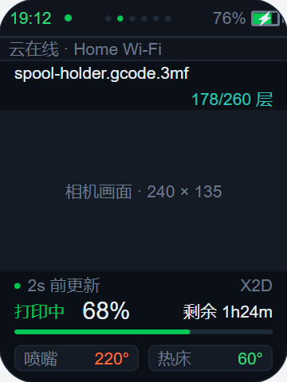

# AI Passport 摄像头第二页 UI 设计

日期：2026-11-07。本设计已接入 AI Passport 主应用的第二页，使用独立 JPEG 取图。X2D 为当前实测机型；配置按序列号保存，图片布局按实际 JPEG 宽高计算，不固定源尺寸或机型。

## 布局

复用 `main/app_printer.c` 的深蓝黑底、绿色进度、橙色喷嘴、青色层数，以及现有 14 / 20px 字体层级、细边框和 6px 信息块圆角。顶部时钟、云状态点、电量、常驻告警条的含义与原页一致。监控页不再显示 `CAMERA` 大标题，顶部直接显示当前任务名称。

| 屏幕区域（绝对坐标） | 内容 |
| --- | --- |
| y=0…31 | 原顶部状态栏；页点选中第二个，页面数按实际 AMS 数量计算 |
| y=32…50 | 原常驻云 / WiFi 摘要或 HMS 告警；告警出现时不移动画面 |
| y=52…73 | 当前任务名，白色、单独占一行；沿用 14px 中文任务字体，超出省略，不滚动干扰画面 |
| y=74…91 | 层数，例如 `178/260 层`，靠右对齐 |
| x=0, y=92, w=240, h=135 | 相机显示区域。按实际图片比例完整显示，不裁切或拉伸；非 16:9 图片居中留黑边 |
| y=230…247 | 左侧画面更新时间，例如 `2s 前更新`；右侧当前机型 / 短名称 `X2D` |
| y=248…273 | 打印状态、百分比、剩余时间，例如 `打印中 68%` / `剩余 1h24m` |
| x=12, y=276, w=216, h=4 | 细进度条，沿用绿色含义 |
| y=289…310 | 两个信息块：喷嘴当前温度（橙色）、热床当前温度（绿色）；详细当前 / 目标温度仍在温度页 |

正文不增加暂停 / 停止等控制按钮，实体按键继续负责翻页和确认。画面周围只放本页常用信息，AMS、风扇、详细温度等仍在各自页面。

## 页面顺序与按键

详情顺序：**进度 → 监控 → 温度 → AMS（每台一页）→ 设备 → 控制**。第一页保持原有进度设计，新增监控固定为第二页。

启动或从菜单重新进入时恢复上次浏览的打印机与页面。页面类型和打印机序列号保存在独立的 `printer_ui` NVS 命名空间；只有位置发生变化才提交，定时数据刷新不会重复写入。没有历史记录时，单机进入进度首页，多机进入概览。打印机排序与 AMS 页数改变时按身份恢复，原机器被移除则回默认入口；AMS 页先等待打印机状态，确认原页面不可用时回进度页。停止打印的二次确认等临时控制状态不恢复。

- 上 / 下短按：沿用原来的循环切页；从进度页按下进入监控。
- OK 短按：请求刷新快照，不切换打印状态，不发送打印控制命令。
- OK 长按：沿用返回机器概览 / 菜单的行为。
- 进入本页后开始取图，离开本页取消取图；已有任务的结果必须检查当前机器与页面会话，避免晚到画面覆盖其他页面。
- 本页正在观看时保持亮屏；其他页面保持原有休眠策略。按键与切页不等待网络接收完成，退出后的数据通过页面会话令牌丢弃。

多机时画面、任务、进度、层数与温度必须来自同一台当前选中打印机。不用固定的 `X2D` 字样替代当前机器身份。

## 状态设计

| 状态 | 画面区域 | 打印信息与更新时间 |
| --- | --- | --- |
| 正常打印 | 完整快照，不覆盖画面 | 显示状态、百分比、剩余时间、层数与温度；成功更新后才归零图片年龄 |
| 空闲 | 仍可看机舱 | 任务名改为“等待任务”，进度与剩余显示 `--`，层数 `--/--`，温度保留真实值 |
| 首次连接 / 尚无照片 | 暗底占位，显示连接状态 | 不显示虚假的更新时间 |
| 画面中断 | 保留最后成功画面并压暗，标明“画面连接中断 / 最后画面 · Ns 前” | 黄色提示图片未更新；打印状态仍按自己的数据源更新，不能把相机失败误报为打印失败 |
| 未配置 / 不支持 | 同尺寸占位，不移动下方信息 | 明确提示未配置相机或当前机型不支持；不显示成功状态 |

不使用 `LIVE`、红色录制点或模拟帧率，以免把约数秒刷新的 JPEG 当作连续视频。实际页面用 `Ns ago` / `Ns old - retrying` 标记图片年龄。超过 12 秒或确认断连后显示黄色过期提示，重试成功才撤销。

为避免分配整张图片，实际固件在断连时保留最后验证成功的画面，并在其下方明确标记过期，不绘制预览中的半透明全图遮罩。若新图片接收中断或校验失败，清除未验证的部分画面，再显示重连占位。正式页面新提示文案用英文，原有打印状态与温度标签保持现有样式。

## 动态尺寸与多机设置

设置方法：长按 OK 返回菜单，进入原配网功能；手机连接设备的设置热点并打开配网页。在已有打印机账号配置的基础上展开 `Camera (optional)`，选择对应打印机，填写打印机 IP / 主机名与 LAN 访问码，保存并重启。IP 留空可停用该台相机。取图需要打印机与 Passport 局域网可达，并按机型开启 LAN Liveview；云端 token 不是 LAN 访问码。监控是第二页，从进度页按“下”进入；以后启动自动恢复上次页面。

首次连接会核对打印机证书中的序列号并保存证书指纹；指纹改变时拒绝发送访问码，在确认更换 / 更新后可勾选配网页的重新配对选项。不会在源码中写入某台机器的 IP、访问码或证书。

- 源宽高从 JPEG 头读取；使用 ROM 的 1/1、1/2、1/4、1/8 解码及分块重采样，完整适配显示区域。
- 例如 1920×1080 显示 240×135，1280×960 显示 180×135，480×640 显示 101×135；小图不强制放大。
- 每台打印机有独立的 IP / 主机名、LAN 访问码、短名称和协议选择。配置通过序列号索引，与机器排列顺序无关；默认名称来自当前机器或显示通用 `Printer`，不把 X2D 写死在产品代码中。
- 配网页 `Camera (optional)` 可逐机设置。LAN 访问码使用密码输入框，留空保留已存值，接口只返回“是否已保存”，不会回显访问码或证书指纹。
- 支持自动尝试、JPEG 预览以及 A1/P1 JPEG 流协议。后者需要跳过连接时回放的首张缓存画面；尚无其他机型的实机验证，不能据此承诺所有打印机兼容。
- 当前验证范围是 baseline JPEG，源尺寸上限 8192×8192、压缩文件上限 2 MiB；超限或不支持的编码显示提示，不申请源分辨率的完整 RGB 缓冲。本板不直接解码 RTSPS/H.264 视频。

## 原型与实际数据的边界

预览源文件：`docs/design/passport-camera-ui.html`，任务名 / 层数两行布局与透明闪电已按当前固件同步。预览包含第二页、用于风格对照的原进度页，以及打印中 / 空闲 / 画面中断三种示例状态。底部三个按钮仅模拟实体按键，浏览器中的上 / 下只在这两张预览页面间切换，不代表正式固件只剩两页。OK 模拟一次成功的手动刷新。

预览中的任务名、进度、温度、时钟、电量和 WiFi 名均为示例，不是当前遥测。照片由本地已采集的 JPEG 注入，不进行实时连接；照片与含照片预览均不进入 Git。源文件不注入照片时显示同尺寸占位。

供 PR 审阅的静态布局截图如下：相机区域使用占位，全部信息为示例，不包含设备照片、凭据或真实遥测；它是浏览器布局截图，不是设备屏幕读回。

浏览器布局与交互已检查：736px 和 320px 宽度无横向溢出，图像保持 16:9；三种状态、手动刷新模拟和第一页 / 第二页切换均正常，无 JavaScript 错误。固件侧仍需按现有 LVGL 字体实际字宽核对。

## 接入 LVGL 时的约束

- 可新增实体页槽 `8` 作为监控，把 `PAGE_MAX` 扩为 9；导航映射变为 `[0, 8, 1, AMS..., 6, 7]`，保留已有 AMS / 设备 / 控制槽位。刷新逻辑按实体页分派，避免把新增导航序号当作旧槽位。
- 只在本页创建必要对象，切走释放 / 停止相机资源；不默认扩大 LVGL 池或分配全帧 JPEG / RGB 缓冲。
- JPEG 条带显示与 LVGL 的 SPI 刷新必须统一调度，避免下方信息刷新把相机区域清空，或网络任务在退出页面后继续画图。
- LCD 的 LVGL 刷新与相机条带共用串行完成回调；LVGL 避开正在显示照片的行。任务携带页面会话令牌，切页后旧任务不能继续画图。
- 单个 LVGL DMA 缓冲从 40 行缩为 20 行，保持原 LVGL 内存池大小；相机与云 MQTT 分别协商 4096 字节 TLS 分片，减少连续内存竞争，MQTT 证书验证和完整报文解析保持不变。
- TLS 握手时完成证书校验，握手后不保留对端证书链；相机的证书序列号和指纹仍在校验回调中检查。相机显示缓冲按缩放后的 MCU 条带分配；连续内存不足时降为 512 字节的逐 MCU 缓冲，始终不申请全帧内存。
- 尺寸验证已在板上通过：10 个预期布局、196 组坐标映射和无效尺寸边界。用户已确认主应用中的真实画面、打印信息，以及首页与监控页来回切换正常。

## 主应用实机验证

2026-11-07，ESP32-C3 AI Passport（无 PSRAM）与 X2D 同一局域网，主应用同时运行云 MQTT 和相机页：

- 约 4 分钟内成功接收、解码并校验 48 张图片；首次成功出图后 0 次失败。启动时 WiFi 尚未就绪的一次重试不计入出图后失败。
- 图片成功更新间隔中位数 4.819 秒；这是定时 JPEG 快照，不是连续视频。
- 云连接建立 1 次、断开 0 次，期间持续收到 22 次节流打印状态摘要；未发现 TLS 分配失败、断言、看门狗或重启。
- 每次取图结束后的最小空闲堆为 40,552 字节，最小最大连续空闲块为 21,504 字节；这些数值不是 TLS 握手期间的内存最低值，也不代表长期稳定性保证。
- 此轮检查关闭强制进入监控页与启动尺寸自测，从进度首页启动。后续新增了页面记忆，正式启动按最近保存的位置恢复。仅改写应用分区；已有 WiFi、账号 token 和打印机配置保持原值，相机配置另存于按序列号索引的 NVS 命名空间。

已通过 ESP-IDF 5.5.3 构建、6 个主机协议边界测试、板上尺寸与坐标映射自测、配网页交互检查。实际相机、打印信息、颜色方向及来回切页已有用户确认；其他打印机的协议与图片编码仍需逐机实测。

### 页面记忆与标题调整验收

2026-11-07：用户实际翻到监控第二页后，日志确认 NVS 保存实体页槽 8；USB 硬复位后，关闭强制跳页的正式固件直接恢复到第二页，并继续接收相机画面及云端状态。启动没有重复提交相同页面记录。回读 NVS 确认页面记录为版本 1 / 详情页 / 槽 8，已有 14 项账号与网络配置、6 项相机配置均保留。用户已确认任务名单独位于顶部、层数下一行右对齐的布局正常。多机与 AMS 变化的恢复逻辑已做代码检查，当前设备仅有一台打印机，未宣称完成多机实机验收。
