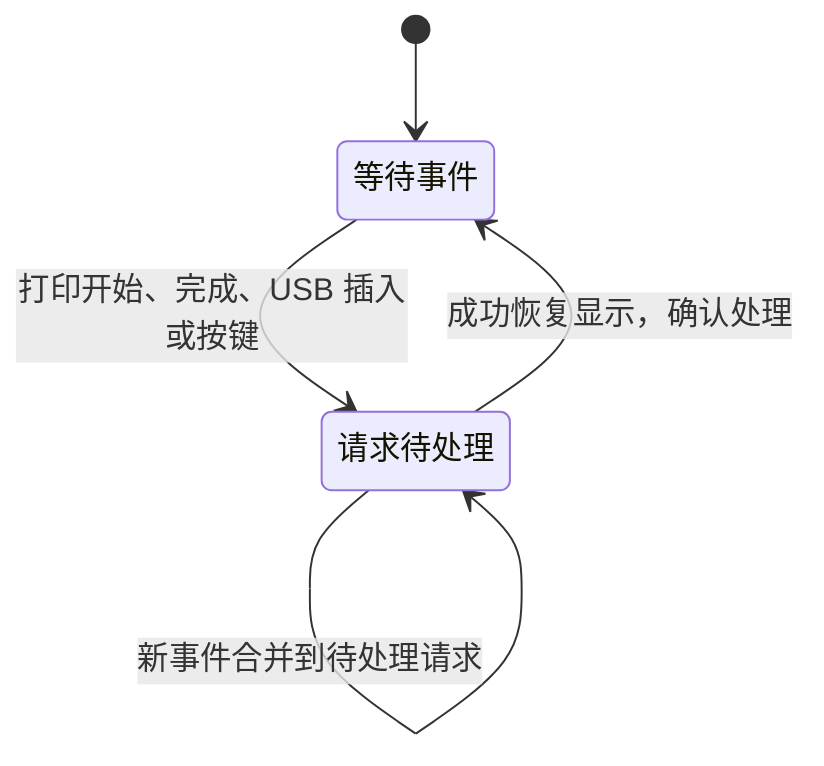
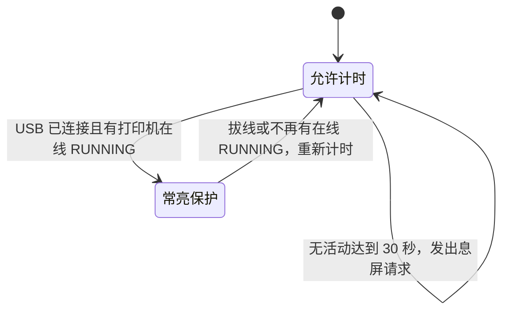

# AI Passport 亮屏与休眠状态转换

适用分支：`research/live-camera-monitor`。日期：2026-11-08。

本规则由用户确认。亮屏请求和息屏策略是两个独立状态机，屏幕执行层负责仲裁；不能用“当前插电／当前打印中”代替一次真实的状态变化事件。

## 亮屏状态机：处理一次性事件

状态为“等待事件”和“请求待处理”。它只观察事件，不决定是否允许休眠。

| 事件 | 当前黑屏 | 当前亮屏 |
| --- | --- | --- |
| 已知非 `RUNNING` 状态进入 `RUNNING`，包括暂停后继续 | 请求亮屏，恢复原页面和显示任务 | 保持亮屏，重新开始 30 秒计时 |
| `RUNNING`／`PAUSE` → `FINISH` | 请求亮屏，恢复原页面和显示任务 | 保持亮屏，重新开始 30 秒计时 |
| USB 检测由未连接变为已连接 | 请求亮屏，与是否打印无关 | 保持亮屏，重新开始 30 秒计时 |
| 用户按键 | 请求亮屏，此次按键仅唤醒 | 执行原有操作，重新开始计时 |
| 相同状态的重复报文、无状态字段的遥测 | 无动作 | 不重置计时 |
| 开机首次收到 `RUNNING`／历史 `FINISH` | 只建立基线，无亮屏事件 | 不额外重置计时 |
| 暂停、失败、拔掉 USB | 本身不触发亮屏 | 本身不触发亮屏，交给休眠策略判断 |

只有“进入打印中”和“活动任务完成”产生打印事件；`IDLE` → `FINISH` 不能证明发生了新的任务完成，不触发。每台打印机维护自己的前一状态，任一已配置打印机的真实事件都可唤醒设备，不受当前所看页面／打印机限制，也不自动切换页面。

打印事件由 MQTT 报文解析产生，使用事件序列交给屏幕检查逻辑，不直接在网络回调中操作 LVGL。重复快照不产生新事件；检查间隔内多个事件可合并为一次亮屏，当前页面仍显示最新遥测。显示恢复失败时请求保留，后续重试，30 秒从成功点亮后开始计算。

启动时 USB 当前值作为基线，开机已经插着 USB 不算一次新的插入。网络重连本身也不产生亮屏事件；重连后按每台机器保留的前后打印状态判断。

## 休眠状态机：决定能否超时息屏

状态为“允许计时”和“常亮保护”。它只接收当前供电、打印状态以及活动时间，不消费打印事件，不直接产生亮屏请求。

| 当前条件 | 策略 |
| --- | --- |
| 电池供电，任意打印状态 | 允许计时，30 秒无操作后请求息屏 |
| 检测到 USB，未打印／暂停／完成／失败／未知 | 允许计时，30 秒无操作后请求息屏 |
| 检测到 USB，任一已配置打印机在线 `RUNNING` | 常亮保护，不发出超时息屏请求 |

打印状态是否在线与是否 `RUNNING` 共用现有 MQTT 状态模型。暂停／完成／失败／未知及云连接断开均不满足常亮保护。常亮保护只阻止息屏，不把首次收到的历史状态转换成亮屏事件。

## 屏幕执行层与优先级

每次检查分别更新两个状态机，然后统一执行：

1. 有待处理亮屏请求时优先恢复画面、LVGL、背光和原页面的相机取图；成功后确认请求并重置空闲时间。屏幕已经亮着也会重置一次计时。
2. 没有亮屏请求，且休眠策略发出超时请求时，才关闭背光，暂停 LVGL 与相机取图。
3. 同时收到亮屏事件和 30 秒超时，亮屏优先，避免同一轮先亮后黑。
4. 退出常亮保护后从该次检查重新计时，不使用常亮前的过期时间立即息屏。

例如电池模式：

`黑屏 → 开始打印事件 → 亮屏 → 30 秒无操作 → 黑屏 → 完成事件 → 亮屏 → 30 秒无操作 → 黑屏`

例如插电但未打印：

`黑屏 → 插入 USB → 亮屏 → USB 保持连接但无新事件 → 30 秒无操作 → 黑屏`

例如插电打印：

`开始打印事件 → 亮屏，同时进入常亮保护 → 打印期间持续亮屏 → 完成事件重置计时，退出常亮保护 → 30 秒无操作 → 黑屏`

## 网络与硬件边界

此处休眠指息屏、暂停界面和相机取图。WiFi、MQTT 与事件检查仍运行，CPU 空闲时按现有 PM 配置自动轻睡眠；不进入会关闭网络的深睡。断网期间不能保证即时感知打印变化，也不补播无法确认的历史事件。每秒检查一次事件，另外还有云端传输延迟。

“插电”当前使用与闪电图标相同的 USB 主机 SOF 检测，只能可靠识别电脑 USB，不能据此承诺普通充电头／充电宝检测。USB 在轻睡眠中的重新枚举仍受硬件／驱动约束，电池息屏后实际插线唤醒需实机验证；按键唤醒保留。闪电显示只由 USB 检测决定，与这两个状态机独立。

实现入口：`main/app_screen_policy.c`（两个状态机）、`main/main.c`（屏幕执行）、`main/app_mqtt.c`（逐机打印事件）。验证命令与桩边界见 [主机回归说明](../tools/tests/README.md)。

## 验证记录

2026-11-08：41 项主机测试及 ESP-IDF 5.5.3 / ESP32-C3 构建通过。主机回归直接编译实际 MQTT 解析、两个状态机和屏幕回调，使用硬件／网络桩；覆盖两种供电下开始／完成事件、USB 插入一次唤醒、首次与重复状态、重连、部分遥测、独立打印机历史、暂停继续、超时与亮屏同时发生、显示锁失败重试、延迟按键唤醒消费原 CLICK，以及事件合并／序列回绕。

已向 AI Passport 仅写入应用分区，固件内容校验通过，原 NVS 24 KiB 回读逐字节一致。硬复位后的 42 秒串口观察中，历史状态为 `FINISH`，亮屏事件处理与提示音状态转换记录均为 0；启动约 30.6 秒执行息屏，无崩溃或看门狗标记。未向打印机发送控制命令。

电池下实际开始／完成打印、息屏后实际插线唤醒、目视画面恢复及休眠电流仍需实机验收；不能把主机桩测试或本轮 USB 启动日志当作这些场景已经通过。
